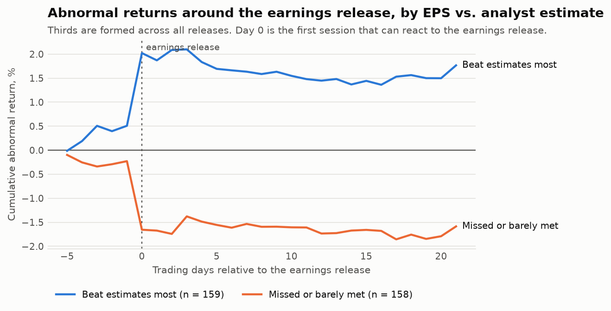
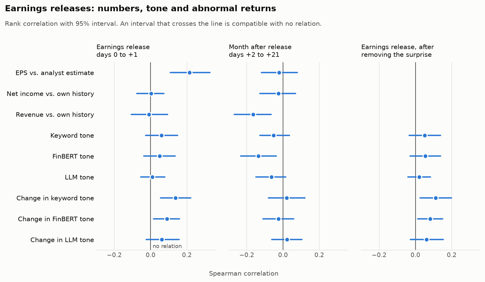
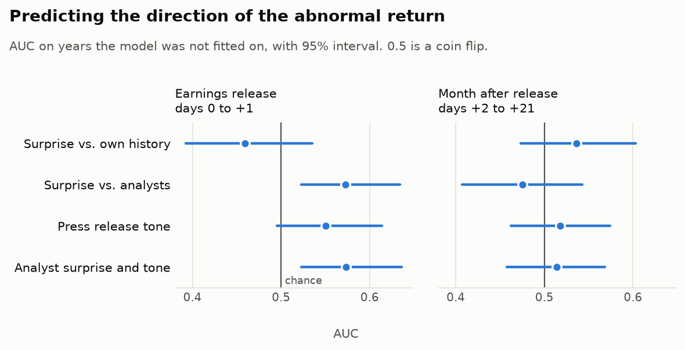
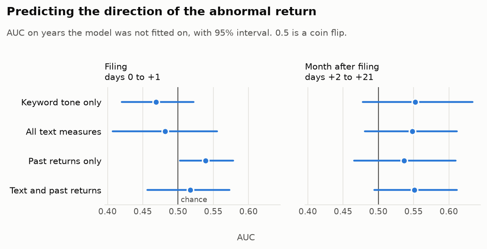
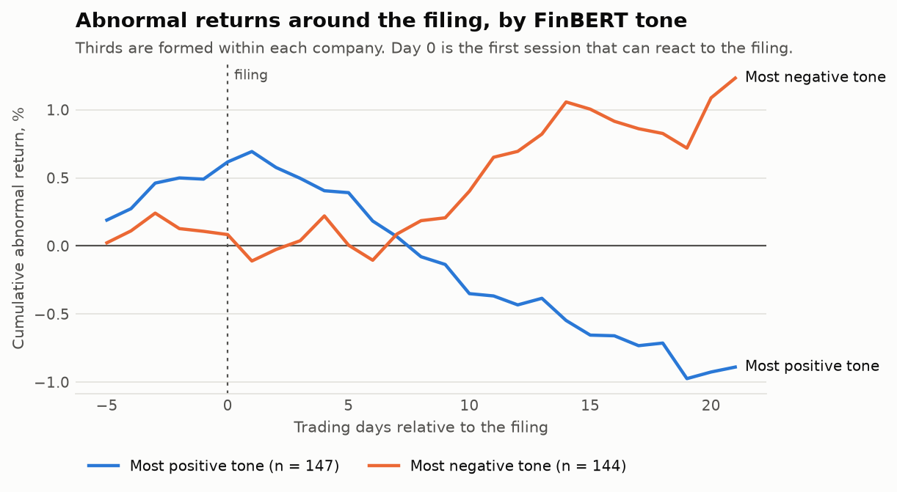

# What in a company's reporting shows up in its stock price?

The original proposal promised a "market reaction predictor" and expected the tone of a filing, as judged by an LLM, to correlate with the price move at more than 0.35. This study tests that on the project's data, first for the earnings release and then for the 10-K/10-Q that follows it.

**Result in short**

- **The earnings release is what moves the stock.** On release days the stock moves 2.9 times its usual amount. The 10-Q or 10-K that follows days later moves it no more than an ordinary day.
- **The direction follows the surprise against analyst estimates.** The third of releases that beat estimates most gained 1.4% against the market over two days; the third that missed or barely met them lost 1.4%.
- **Compared with the company's own history, the same numbers say nothing.** What counts is what the market expected, and that is not in the filings.
- **The press release's tone adds a little.** A release that sounds better than the company's previous one goes with a better reaction, also after accounting for the surprise. The effect is small and shows for the keyword count, not for the LLM.
- **Nothing predicts the following month.** After the release day, the information is in the price.
- **The filing text is unrelated to the reaction**, and the LLM is no better at any of this than a keyword count. The proposal's target of 0.35 is not reached by any measure.

## Data

| | |
|---|---|
| Companies | 20 large US companies across sectors |
| Period | January 2019 to December 2024 |
| Earnings releases | 479, from SEC EDGAR (8-K filings with item 2.02) |
| Press releases | Exhibit 99.1 of each of those 8-Ks; 477 with enough prose to score |
| Filings | 479 (120 10-K, 359 10-Q); 437 with a usable MD&A, from 19 companies |
| Analyst estimates | Consensus EPS before each release, from Yahoo Finance (476 releases) |
| Reported figures | Quarterly net income and revenue from SEC structured data (XBRL) |
| Prices | Daily adjusted closes from Yahoo Finance; S&P 500 ETF (SPY) as the market |

JPMorgan's 10-K and 10-Q do not use the standard item headings, so its MD&A cannot be extracted. Its press releases are included.

## Method

### When did the market learn what?

A company announces its results in an earnings release and files the 10-Q or 10-K the same day or up to several weeks later. Every filing was matched to its earnings release.

- 54% of the releases and 84% of the filings reached EDGAR after the market had closed; nearly all other releases came before it opened. Each event is dated to the first trading session that could react to it, using the acceptance time rather than the calendar date.
- 32% of the filings reach the market in the same session as the release. The median gap is 3 trading days.

### Abnormal returns

A stock's raw return mostly reflects what the whole market did that day. The study uses abnormal returns: the stock's return minus what its usual relation to the market (estimated over the preceding year) predicts. Day 0 is the first session that can react.

- **Days 0 to +1**: the reaction.
- **Days +2 to +21**: the month after. Only here is everything known before the window starts.
- **Move size**: the absolute abnormal return on day 0, in units of the stock's ordinary daily move. An ordinary day averages about 0.8.

### What is measured

**Numbers**

- **Surprise against analysts**: reported EPS relative to the consensus estimate, in percent.
- **Surprise against the company's own history**: net income and revenue compared with the same quarter a year earlier, relative to how that change usually turns out for the company. This uses only what companies file with the SEC.

**Tone**, of the press release and of the filing's MD&A section, each measured three ways:

- **Keyword tone**: positive minus negative words from a short list.
- **FinBERT tone**: a BERT model trained on financial sentiment, applied sentence by sentence.
- **LLM tone**: the project's LLM (Qwen 1.5B), asked whether each chunk is positive, negative or neutral.

For each tone measure also its **change** against the company's previous release or filing. For filings, additionally how much the MD&A and Risk Factors were **rewritten**.

Tone is compared within a company: what counts is whether a text is more positive than the same company's other texts.

### Statistics

- **Association**: rank correlation of each measure with each return window. Events in one earnings season are not independent, so the 95% intervals come from resampling whole calendar quarters, and p-values are adjusted for the number of tests.
- **Prediction**: a logistic regression is fitted on all years before a test year and predicts the direction of the abnormal return in that year, for 2022, 2023 and 2024. The score is the AUC: the probability that an event followed by a positive return was ranked above one followed by a negative return. 0.5 is a coin flip.
- **Robustness**: every direction result is repeated with a simpler return definition (stock minus market).

## Part 1: the earnings release

### The release is visible, the filing is not

| Day | Mean move size | Median | Share above 2 |
|---|---|---|---|
| Earnings release | 2.9 | 2.3 | 55% |
| Filing, when published at least two sessions after the release | 0.7 | 0.5 | 4% |

On more than half of the release days the stock moves more than twice its usual amount. The filing, when it comes later, is a non-event.

### Direction follows the surprise against analysts



| Third of releases | Median surprise | Mean abnormal return, days 0 to +1 | Share with a positive reaction | Mean move size |
|---|---|---|---|---|
| Missed or barely met | +0.4% | −1.4% | 40% | 3.4 |
| Middle | +6.1% | +0.6% | 58% | 2.7 |
| Beat most | +18.7% | +1.4% | 59% | 2.5 |

- Companies beat the estimate in 86% of the releases, so merely meeting it counts as a disappointment.
- The whole adjustment happens on the release day. The lines are flat afterwards: there is no drift to exploit.
- Disappointments move the stock more than positive surprises do.

### All measures at the release



- **Surprise against analysts**: correlation 0.21 with the reaction (interval 0.11 to 0.33), positive in each of the six years.
- **Surprise against own history**: 0.00 for net income and −0.01 for revenue. The same reported figures carry no information about the reaction once they are measured against the past instead of against expectations.
- **Tone level**: no relation (0.06, 0.05 and 0.01 for keywords, FinBERT and the LLM).
- **Change in tone**: 0.14 for keywords (interval 0.06 to 0.22), 0.09 for FinBERT, 0.06 for the LLM. Only the keyword result survives the adjustment for multiple tests.
- **Tone beyond the numbers** (right panel): after removing what the surprises explain, the change in keyword tone still correlates at 0.11 (interval 0.03 to 0.20). The wording carries a little information that the EPS figure does not.
- **Month after the release** (middle panel): the analyst surprise is at −0.02. Two measures are negative here, revenue against own history (−0.16) and FinBERT tone (−0.14). The first disappears with the simpler return definition (−0.05); the second is discussed below.

With the simpler return definition the release-day results are unchanged (0.21 for the analyst surprise, 0.13 for the change in keyword tone).

### Size of the move

Neither the size of the surprise nor the tone relates to how large the move is or to how volatility changes afterwards. Of 18 tests, none survives the adjustment. The one pattern is in the table above: disappointments produce larger moves.

### Prediction



| Target | Features | AUC | 95% interval |
|---|---|---|---|
| Release, days 0 to +1 | Surprise vs. own history | 0.46 | 0.39 to 0.54 |
| Release, days 0 to +1 | Surprise vs. analysts | 0.57 | 0.52 to 0.63 |
| Release, days 0 to +1 | Press release tone | 0.55 | 0.50 to 0.61 |
| Release, days 0 to +1 | Analyst surprise and tone | 0.57 | 0.52 to 0.64 |
| Month after | Surprise vs. own history | 0.54 | 0.47 to 0.60 |
| Month after | Surprise vs. analysts | 0.48 | 0.41 to 0.54 |
| Month after | Press release tone | 0.52 | 0.46 to 0.57 |
| Month after | Analyst surprise and tone | 0.51 | 0.46 to 0.57 |

238 releases in 2022–2024. The analyst surprise tells the direction of the release-day reaction better than chance, modestly. Adding tone does not improve on it. Nothing tells the direction of the following month.

Two cautions:

- **This is not a trading signal.** The release and the reaction happen together: most releases come out while the market is closed, and the price has moved by the time it reopens. The model explains the reaction; it does not get ahead of it.
- **Accuracy is unimpressive.** The best model is right in 57.6% of cases, and 55.9% of the reactions in those years were positive.

## Part 2: the 10-K and 10-Q

### Association


- **Earnings release and filing day**: nothing. No correlation in these panels exceeds 0.07, and every interval includes zero. This also holds for the 277 filings published at least two sessions after the release (right panel).
- **Month after filing**: the three tone levels are negatively related to the abnormal return: −0.15 (keywords), −0.21 (FinBERT) and −0.19 (LLM).

### Prediction



| Target | Features | AUC | 95% interval |
|---|---|---|---|
| Filing, days 0 to +1 | Keyword tone only | 0.47 | 0.42 to 0.52 |
| Filing, days 0 to +1 | All text measures | 0.48 | 0.41 to 0.56 |
| Filing, days 0 to +1 | Past returns only | 0.54 | 0.50 to 0.58 |
| Filing, days 0 to +1 | Text and past returns | 0.52 | 0.46 to 0.57 |
| Month after | Keyword tone only | 0.55 | 0.48 to 0.63 |
| Month after | All text measures | 0.55 | 0.48 to 0.61 |
| Month after | Past returns only | 0.54 | 0.47 to 0.61 |
| Month after | Text and past returns | 0.55 | 0.49 to 0.61 |

220 filings in 2022–2024. No text model is distinguishable from chance.

## An open lead: positive tone, lower returns afterwards

In both parts, a more positive tone goes with a *lower* abnormal return over the following month: for the MD&A (−0.15 to −0.21) and for the press release (FinBERT, −0.14).



Reasons not to rely on it:

- **It depends on how returns are defined.** The main definition subtracts each stock's recent trend. A stock that has done well gets a higher trend and therefore a lower abnormal return for the same price path, and companies that have done well also write more positively. With the simpler definition the MD&A correlations shrink to −0.11, −0.13 and −0.10, with only FinBERT's interval excluding zero, and the press release result to −0.11.
- **It does not predict.** Models fitted on earlier years do not tell the direction of the following month better than chance, in either part.

It appears in two different texts, and for the MD&A in each of the six years, so it may be worth testing on a larger sample. As it stands it is a lead, not a finding.

## What this means

- **Prices react to surprises, not to levels.** What moves a stock is the gap between the results and what was expected. Expectations come from outside the company's filings, which is why measures built from the filings alone show nothing.
- **The filing is late.** By the time most 10-Qs appear, the results have been public for days.
- **Wording matters only as a change.** How positive a press release sounds says nothing; whether it sounds better than last quarter's says a little.
- **A bigger model did not help.** The simple keyword count did at least as well as FinBERT and better than the LLM. The three agree only moderately (rank correlations of 0.2 to 0.7).
- **These are among the most closely followed companies in the world.** Anything a simple score could predict about them would have been traded away.

## Limitations

- 20 large companies over six years. The sample is small, and all companies survived the period.
- Daily prices. Most releases come out while the market is closed, so the reaction cannot be separated into the release itself and the conference call that follows.
- Analyst estimates are taken from Yahoo Finance as provided and are not checked against a second source.
- The surprise against own history uses the latest reported figures, which can include later restatements.
- The LLM was trained on text from after these events and may know how things turned out. Since it found the least, this did not help it.
- Of the many tests, a few would come out "significant" by chance. The adjustment for multiple testing addresses this within each table, not across the whole study.

## Reproduce

```bash
uv run scripts/01_download_data.py --all       # 20 companies, about 9 GB
uv run scripts/02_process_documents.py         # about 15 minutes
uv run scripts/08_text_price_study.py          # filings; LLM scoring about 25 minutes on an RTX 3060 Ti
uv run scripts/09_earnings_release_study.py    # releases; downloads press releases, about 20 minutes
```

Tables are written to `data/processed/study/`, figures to `docs/figures/`. Intermediate results are cached; `--refresh` recomputes them and `--no-llm` skips the LLM measure. The code is in `src/earningsiq/study/`.
