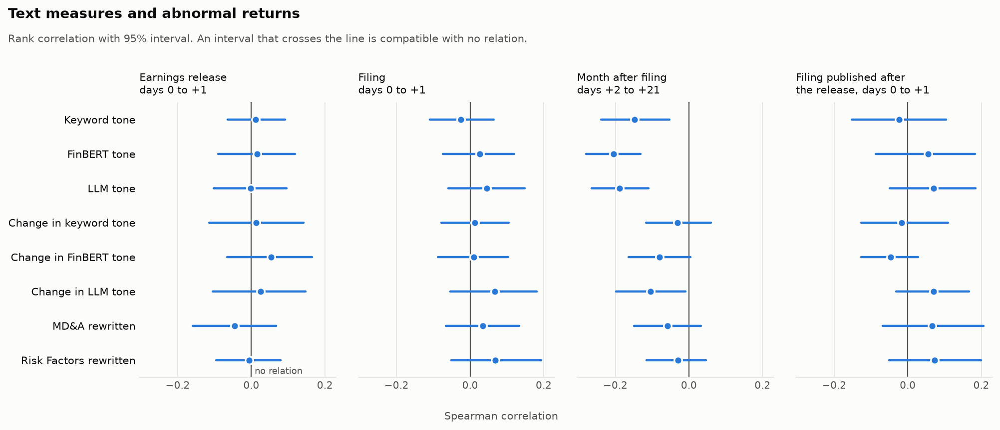

# Does the language of a filing relate to the stock's reaction?

The original proposal promised a "market reaction predictor" and expected the tone of a filing, as judged by an LLM, to correlate with the price move at more than 0.35. This study tests that on the project's data.

**Result in short**

- The **earnings release is clearly visible** in the stock price; the 10-Q or 10-K that follows it days later is not.
- The tone of a filing's MD&A section has **no measurable relation to the price reaction** on the day of the earnings release or the day of the filing. All correlations are between −0.05 and +0.07.
- The LLM is **not better than a keyword count** at this. The proposal's target of 0.35 is not reached by any measure.
- Filings with a more positive tone were followed by **lower** returns over the next month. This holds in the sample but weakens under a simpler return definition and **does not help prediction** on later years, so it is a lead, not a finding.
- A model fitted on earlier years **cannot predict the direction** of the abnormal return in 2022–2024 better than chance.

## Data

| | |
|---|---|
| Companies | 20 large US companies across sectors |
| Filings | 479 (120 10-K, 359 10-Q), January 2019 to December 2024 |
| With a usable MD&A | 437 filings from 19 companies |
| Prices | Daily adjusted closes from Yahoo Finance; S&P 500 ETF (SPY) as the market |
| Earnings releases | From SEC EDGAR: each company's 8-K filings with item 2.02 |

JPMorgan's filings do not use the standard item headings, so its MD&A cannot be extracted and it drops out of all text measures. The same affects a few filings of Chevron, Pfizer, Visa and Coca-Cola.

## Method

### When did the market learn what?

A 10-Q is usually not news by itself: the company announces its results in an earnings release first and files the 10-Q the same day or up to several weeks later. Every filing was therefore matched to its earnings release.

- 84% of the filings reached EDGAR after the market had closed. Each event is dated to the first trading session that could react to it, using the acceptance time rather than the filing date.
- 32% of the filings reach the market in the same session as the earnings release. The median gap is 3 trading days.

### Abnormal returns

A stock's raw return mostly reflects what the whole market did that day. The study uses abnormal returns: the stock's return minus what its usual relation to the market (estimated over the preceding year) predicts. Four windows are measured:

| Window | Meaning |
|---|---|
| Earnings release, days 0 to +1 | Reaction to the results |
| Filing, days 0 to +1 | Reaction when the filing appears |
| Filing, days 0 to +1, later filings only | The same, for the 277 filings published at least two sessions after the release, where the window no longer contains the release |
| Month after filing, days +2 to +21 | What happens afterwards. Only here is the text known before the window starts. |

### Text measures

Tone of the MD&A section, measured three ways:

- **Keyword tone**: positive minus negative words from a short list (the baseline).
- **FinBERT tone**: a BERT model trained on financial sentiment, applied to 78,339 sentences.
- **LLM tone**: the project's LLM (Qwen 1.5B), asked whether each of 13,454 chunks is positive, negative or neutral.

Plus, for each measure, its **change** against the company's previous filing of the same type, and how much the MD&A and Risk Factors texts were **rewritten** (embedding distance to the previous filing).

All measures are compared within a company: what counts is whether a filing is more positive than the same company's other filings, not whether a software company writes more cheerfully than an oil company.

The three tone measures agree moderately (rank correlation 0.64 between keywords and FinBERT, 0.71 between FinBERT and the LLM, 0.46 between keywords and the LLM), so they capture something in common.

### Statistics

- **Association**: rank correlation of each text measure with each return window. Filings of one earnings season are not independent, so the 95% intervals come from resampling whole calendar quarters. With 32 tests, p-values are adjusted for multiple testing.
- **Prediction**: a logistic regression is fitted on all years before a test year and predicts the direction of the abnormal return in that year, for 2022, 2023 and 2024 (220 filings). It is compared with always guessing the direction that was more common before.

## Results

### What is visible: the earnings release, not the filing

Before asking about direction, how large is the move on the event day at all? The table gives the absolute abnormal return on the day, in units of the stock's ordinary daily move. An ordinary day averages about 0.8.

| Day | Mean | Median | Share above 2 |
|---|---|---|---|
| Earnings release | 2.9 | 2.3 | 55% |
| Filing, when published at least two sessions after the release | 0.7 | 0.5 | 4% |

The earnings release is unmistakable in the price: on more than half of these days the stock moves more than twice its usual amount. The filing, when it comes later, is a non-event: the move is no larger than on any other day. The market has the numbers already, and the 10-Q adds nothing it reacts to.

### Association



- **Earnings release and filing day**: nothing. The largest correlation in these three panels is 0.07, and every interval includes zero.
- **Month after filing**: the three tone levels are negatively related to the abnormal return, at −0.15 (keywords), −0.21 (FinBERT) and −0.19 (LLM). These survive the multiple-testing adjustment.

The negative relation is visible in the average price paths:


Three weeks after the filing, the most positive third of filings stands about 0.9% below the market-implied level and the most negative third about 1.2% above it.

### How far to trust the negative relation

Two checks say: not far.

- **It depends on how returns are defined.** The main definition subtracts each stock's recent trend. A stock that has done well gets a higher trend and therefore a lower abnormal return for the same price path, and companies that have done well also write more positively. With the simpler definition (stock minus market) the correlations shrink to −0.11, −0.13 and −0.10, and only FinBERT's interval still excludes zero.
- **It does not predict.** See the next section.

### Prediction


| Target | Features | AUC | 95% interval | Accuracy | Naive guess |
|---|---|---|---|---|---|
| Filing day | Keyword tone only | 0.47 | 0.42 to 0.52 | 47.7% | 50.0% |
| Filing day | All text measures | 0.48 | 0.41 to 0.56 | 48.2% | 50.0% |
| Filing day | Past returns only | 0.54 | 0.50 to 0.58 | 51.8% | 50.0% |
| Filing day | Text and past returns | 0.52 | 0.46 to 0.57 | 51.8% | 50.0% |
| Month after | Keyword tone only | 0.55 | 0.48 to 0.63 | 55.0% | 52.7% |
| Month after | All text measures | 0.55 | 0.48 to 0.61 | 54.1% | 52.7% |
| Month after | Past returns only | 0.54 | 0.47 to 0.61 | 50.9% | 52.7% |
| Month after | Text and past returns | 0.55 | 0.49 to 0.61 | 51.8% | 52.7% |

An AUC of 0.5 is a coin flip. No text model is distinguishable from chance, and none beats the naive guess by a margin whose interval excludes zero. With the simpler return definition, the month-after AUC for all text measures is 0.50.

## Why there is probably nothing to find here

- **Prices react to surprises, not to levels.** What moves a stock on earnings day is the gap between the results and what analysts expected. This study has no expectations data, and the tone of the MD&A is not a substitute for it.
- **The text is late.** By the time most 10-Qs appear, the results have been public for days.
- **MD&A language is cautious and repetitive.** Much of it is carried over from quarter to quarter.
- **These are the most closely followed companies in the world.** If a simple tone score predicted their returns, it would have been traded away.

## Limitations

- 20 large companies (19 with text) over six years. The sample is small, and all companies survived the period.
- No analyst expectations, so the earnings surprise, the main driver of the reaction, is not controlled for.
- Only the MD&A section is scored for tone.
- The LLM was trained on text from after these filings and may know how things turned out. Since it found nothing, this did not help it.
- The month-after windows of a company's consecutive filings do not overlap, but all companies share the same market phases; the quarter-level resampling addresses this only in part.

## Reproduce

```bash
uv run scripts/01_download_data.py --all     # 20 companies, about 9 GB
uv run scripts/02_process_documents.py       # about 15 minutes
uv run scripts/08_text_price_study.py        # LLM scoring takes about 25 minutes on an RTX 3060 Ti
```

Tables are written to `data/processed/study/`, figures to `docs/figures/`. Intermediate results are cached; `--refresh` recomputes them and `--no-llm` skips the LLM measure. The code is in `src/earningsiq/study/`.
